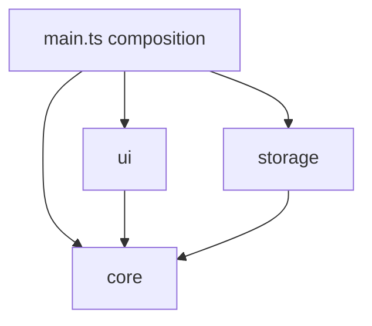
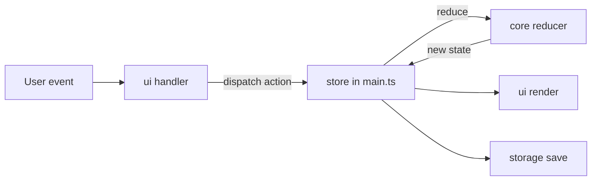
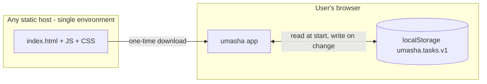

# Architecture Spine — umasha

Items tagged `[ASSUMPTION]` were inferred, not confirmed. Correct any that are wrong.

## Design Paradigm

Functional core, imperative shell. All Task logic is pure functions in `core`. Everything that touches the browser (DOM, localStorage) is a thin shell around it. Data flows one way: event, action, reducer, new state, then render and persist.

| Layer | Directory | Owns |
| --- | --- | --- |
| Core | `src/core/` | Task type, actions, pure `reduce(state, action)`, validation constants |
| Storage | `src/storage/` | Reading and writing the List in localStorage |
| UI | `src/ui/` | DOM creation, rendering from state, event wiring |
| Composition | `src/main.ts` | Creates the store, connects UI and storage |



Dependency direction is a rule: `core` imports nothing from the app or the browser. `ui` and `storage` never import each other.



## Invariants & Rules

### AD-1 — Core is pure and the only place Task state changes

- **Binds:** FR-1, FR-2, FR-3, FR-4
- **Prevents:** UI code, storage code and tests each holding their own copy of Task logic, so Add, Complete and Delete behave differently in different places.
- **Rule:** The List changes only through `reduce(state, action)` in `src/core/`. The reducer is pure: no DOM, no localStorage, no `Date`, no random. Actions are `add(text)`, `toggle(id)` and `remove(id)`. UI code dispatches actions and never edits a Task or the List directly.

### AD-2 — One Task shape; array order is list order

- **Binds:** FR-1, FR-2, FR-4, FR-5
- **Prevents:** Two owners of ordering, or a second field (such as a position or timestamp) that disagrees with the array.
- **Rule:** `Task = { id: string, text: string, done: boolean }`. State is `Task[]`. Order is array order. Add appends to the end, Toggle changes only `done` in place, Remove deletes that element, and no action reorders. No field is added to Task without amending this AD. `id` is created by one function in `core` and never shown to the user. `[ASSUMPTION]` It uses `crypto.randomUUID()`, which needs https or localhost, and is wrapped in that one function so it can be swapped.

### AD-3 — Validation lives in core only

- **Binds:** FR-1
- **Prevents:** The input, the reducer and the stored data disagreeing on what a valid Task is.
- **Rule:** `core` exports `MAX_TASK_LENGTH = 200`. The `add` action trims the text and does nothing if the result is empty. It also does nothing if the text is longer than `MAX_TASK_LENGTH`. The input's `maxlength` attribute reads the same constant. The UI keeps focus on the input and clears it only when the List actually grew.

### AD-4 — One persistence key, one writer, silent failure

- **Binds:** FR-5, NFR-Private
- **Prevents:** Several modules writing storage, drifting key names or formats, or a storage error breaking the app.
- **Rule:** `src/storage/` is the only code that touches localStorage. It uses the single key `umasha.tasks.v1`, whose value is the JSON array of `Task`. State is read once at startup and written by one subscriber after every state change. Any storage error (unavailable, full, blocked) is swallowed and the app continues for the session with no message to the user. `[ASSUMPTION]` Stored data that is not valid JSON, or not an array of valid Tasks, is treated as an empty List. Changing the stored format means a new key (`v2`) and a migration, never a silent edit of `v1`.

### AD-5 — Task text is never parsed as HTML

- **Binds:** FR-1, FR-4, NFR-Private
- **Prevents:** Stored script injection, since Task text round-trips through localStorage.
- **Rule:** Task text reaches the DOM only through `textContent` or `value`. `innerHTML`, `outerHTML` and `insertAdjacentHTML` are not used with Task data.

### AD-6 — Fixed accessible control structure

- **Binds:** FR-2, FR-3, NFR-Accessible, NFR-Responsive
- **Prevents:** Different builders making Complete and Delete from clickable divs, colour-only Done states, or a Delete that fires during a Complete.
- **Rule:** The List is a `ul` with one `li` per Task. Complete is a native checkbox whose label is the Task text, so clicking the text toggles it. Delete is a separate native `button` with an `aria-label` that includes the Task text. Add is a `form` with a text input and a submit button, so Enter works with no extra code. A Done Task is shown with strike-through and dimming, never colour alone. All controls are reachable and operable by keyboard. Layout uses no fixed widths that force horizontal scrolling at 320 px.

### AD-7 — Static, serverless, no telemetry

- **Binds:** NFR-Private, NFR-Fast, NFR-Browsers
- **Prevents:** Quiet growth of a backend, analytics or third-party calls that break the privacy promise and the one-screen restraint.
- **Rule:** The product builds to static files. There is no backend, no API, no analytics, no remote fonts or scripts, and no network request carrying Task data. Rendering after each action is a full re-render of the List from state; this is the accepted approach for the 100 ms target at this scale.

## Consistency Conventions

| Concern | Convention |
| --- | --- |
| Naming | Files `kebab-case.ts`. Types `PascalCase`. Functions and variables `camelCase`. Constants `UPPER_SNAKE_CASE`. Action names are the verbs `add`, `toggle`, `remove`, matching the PRD's Add, Complete, Delete. |
| Data and formats | Task `id` is an opaque string. Text is stored trimmed. No dates are stored. |
| State and cross-cutting | Immutable updates: the reducer returns a new array and never mutates the old one. No global mutable state outside the one store in `main.ts`. No logging in v1. No config or environment variables. `[ASSUMPTION]` Errors are not surfaced to the user in v1, as PRD FR-5 requires for storage. |
| Tests | Vitest unit tests cover `core` and `storage` (against a fake storage object). `ui` is covered by a short manual checklist drawn from PRD SM-1 to SM-4. `[ASSUMPTION]` No end-to-end framework in v1. |

## Stack

| Name | Version |
| --- | --- |
| TypeScript | 7.0.2 |
| Vite | 8.3.5 |
| Vitest | 5.0.5 |
| Node.js (tooling only) | ^22.12.0 or ^24 (verified locally on 24.16.0) |

Versions were checked against the npm registry on 2026-10-26. `[ASSUMPTION]` Scaffold with the `create-vite` `vanilla-ts` template (current create-vite is 9.3.1). If the template pins a different TypeScript version that works, keep the template's version. There is no UI framework and no runtime dependency; the shipped app is plain TypeScript and CSS.

## Structural Seed



```text
{project-root}/
  index.html
  package.json
  vite.config.ts
  src/
    main.ts        # composition: store, wiring
    core/          # Task type, actions, reducer, MAX_TASK_LENGTH (pure)
    storage/       # localStorage load/save for umasha.tasks.v1
    ui/            # render, event handlers, form and list markup
    styles.css
  tests/           # Vitest tests for core and storage
```

Environments: local development with `vite`, and one production build as static files. There is no staging environment. Operations: nothing runs on a server, so there is nothing to monitor or patch beyond updating dependencies. `[ASSUMPTION]`

## Capability → Architecture Map

| Capability / Area | Lives in | Governed by |
| --- | --- | --- |
| FR-1 Add a Task | `core` (add), `ui` (form) | AD-1, AD-2, AD-3, AD-5, AD-6 |
| FR-2 Complete and un-complete | `core` (toggle), `ui` (checkbox) | AD-1, AD-2, AD-6 |
| FR-3 Delete a Task | `core` (remove), `ui` (button) | AD-1, AD-6 |
| FR-4 Show the List and empty state | `ui` (render) | AD-2, AD-5, AD-7 |
| FR-5 Keep Tasks between visits | `storage` | AD-4 |
| NFR Responsive, Accessible | `ui`, `styles.css` | AD-6 |
| NFR Fast | `ui` render | AD-7 |
| NFR Private | whole app | AD-4, AD-5, AD-7 |
| NFR Browsers | build config | AD-7, Stack |

## Deferred

- Hosting provider and deploy pipeline: any static host works and nothing in the code depends on it. Decide when the user wants a public URL.
- Visual design, exact markup and copy of the empty-state hint: owned by the UX step and the builder. AD-6 fixes only the control structure.
- Editing a Task, clear-all-completed, undo for Delete: out of v1 in the PRD. Adding any of them would amend AD-1 (new actions) and may amend AD-2.
- Multiple tabs open at once: v1 does not sync between tabs, and the last write wins. Revisit only if it causes real confusion.
- Linting and formatting tooling: no divergence risk at this size. The builder may add what they like.
- Sync, accounts and multiple devices: PRD non-goals. They would replace AD-4 and AD-7 and need a new spine.
